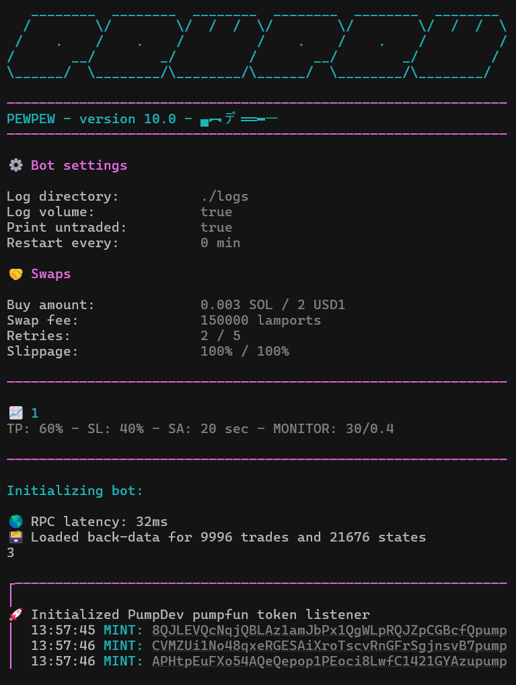
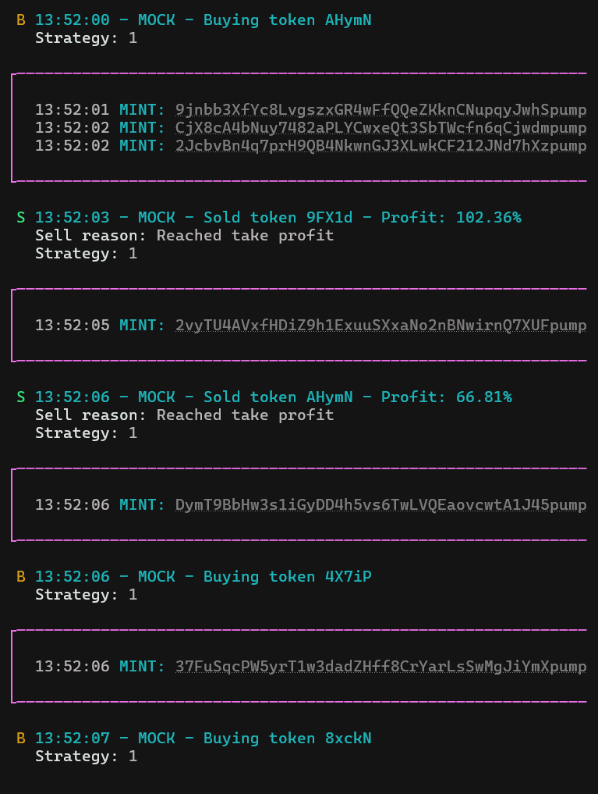

# PumpFun sniper bot 2026

This is the project for the PewPew pumpfun sniper bot, with up to date code for pumpfun in 2026. The bot is able to snipe according to your own strategy and can run several strategies at once.

The bot currently supports PumpFun, BonkFun and Bags.fm

This doc assumes you have node and npm installed.

# HOW TO INSTALL:

1. Run "npm install" to install all neccesary dependencies.
2. On Windows: Run "npm run setup_windows".
   On Linux/WSL2: Run "npm run setup_linux"

If the setup fails for whatever reason scroll down for manual instructions.

An example strategy can be found in ./config/strategies.ts

A more in depth doc is coming soon, but you can always go through the code and figure things out for yourself.

DISCLAIMER: Use this at your own discretion. Start with small amounts to test out the bot. Only increase the amount once you've found a good strategy.

---

# MANUAL PROJECT INSTALLATION

## 1. Install NVM (Node Version Manager)

curl -o- https://raw.githubusercontent.com/nvm-sh/nvm/v0.39.7/install.sh | bash

## Reload shell environment

export NVM_DIR="$HOME/.nvm"
source "$NVM_DIR/nvm.sh"

## 2. Install the latest Node.js and npm

nvm install node

## 2. Install rust

sudo apt install -y curl build-essential pkg-config libssl-dev
curl --proto '=https' --tlsv1.2 -sSf https://sh.rustup.rs | sh
source "$HOME/.cargo/env"
echo 'source "$HOME/.cargo/env"' >> ~/.bashrc
source ~/.bashrc
sudo apt install -y build-essential pkg-config libssl-dev

## Confirm installation

node -v
npm -v

## 3. Install PM2 globally

npm install -g pm2
pm2 -v

## 4. Install Bun using npm

npm install -g bun
bun -v

## 5. Install NGINX

sudo apt update
sudo apt install -y nginx

## 6. Create and expose the logs folder

mkdir -p ~/pump/logs
sudo ln -s ~/pump/logs /var/www/html/pump-logs

## 7. Configure NGINX to serve the logs directory

sudo tee /etc/nginx/sites-available/pump-logs <<EOF
server {
listen 80;
server*name *;

    location /logs/ {
        alias /home/ubuntu/pump/logs/;
        autoindex on;
    }

}
EOF

## 8. Enable the config and restart NGINX

sudo ln -s /etc/nginx/sites-available/pump-logs /etc/nginx/sites-enabled/
sudo nginx -t
sudo systemctl restart nginx

Now accessible via: http://<your-server-ip>/logs/
